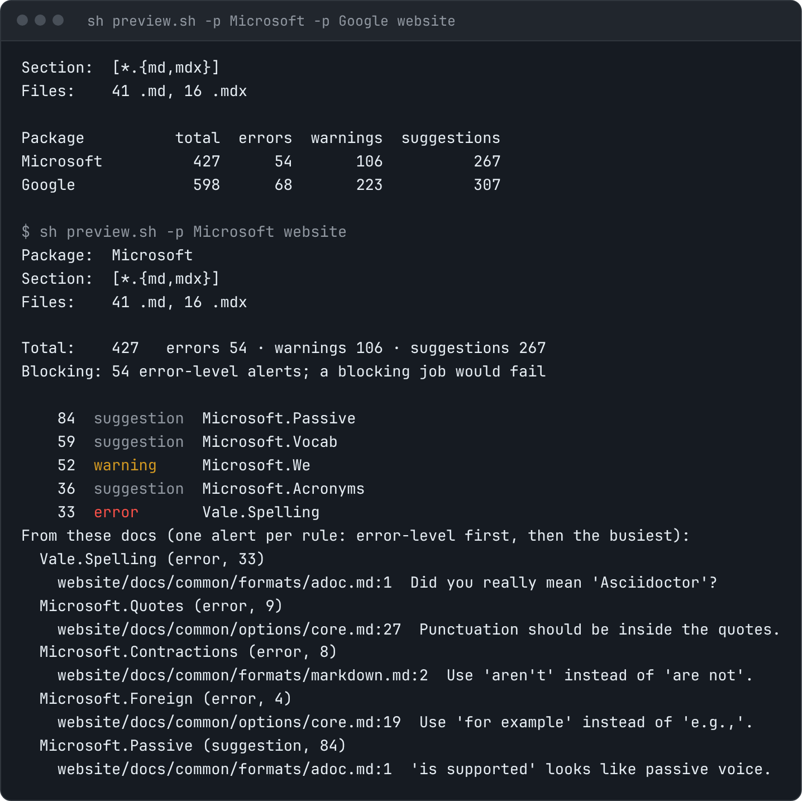

# Vale agent tools

Agent skills, a linting hook, and the Vale CMS MCP server, packaged for coding
assistants.

Everything here drives [Vale](https://vale.sh), the prose linter. The skills run
the CLI in your repository — they edit your files and open your pull requests,
and they need no account.

## Install

In Claude Code, type these two as slash commands (the second one restarts the
session so the hook and the MCP server register):

```
/plugin marketplace add vale-cli/agent-tools
/plugin install vale@agent-tools
```

The plugin drives the `vale` binary; it doesn't bundle it. `/vale:onboard` and
`/vale:setup` install it if it is missing, or see
[installation](https://docs.vale.sh/topics/installation).

Type `/vale:` and thirteen completions should appear. The hook runs on
*Claude's* edits, not yours, and is silent unless a file has an error-level
alert; `/vale:doctor` checks the setup if it seems quiet.

## Set up in one prompt

In a repository that has prose and no Vale yet:

```
/vale:onboard
```

It tries the common style packages against your docs in a temp directory,
drafts a vocabulary and a decision for each noisy rule, and shows you one
proposal — what it found, the before and after counts, the CI job. Nothing is
written until you say yes, and by default the result is a pull request with
that proposal as its description, so the rest of the team reviews the same
thing you did. If Vale itself is missing, it installs it — through a package
manager where one is available, otherwise the checksum-verified release binary.

This is the proposal an agent produced, sixty seconds after being asked to set
up Vale on Vale's own documentation site:


Behind it is a script that tries each package against your docs and shows a
real alert from your own files for every rule that would block:



No plugin support? Any coding agent that can run a shell can do the same:

```
Clone https://github.com/vale-cli/agent-tools into a temp directory, then
follow skills/onboard/SKILL.md to set up Vale in this repository.
```

## What's here

| | | Needs an account |
|---|---|---|
| [Skills](docs/skills.md) | Thirteen `/vale:` skills — setup, doctor, rules, vocabulary, CI, fixes. | no |
| [Hooks](docs/hooks.md) | Lint each file Claude edits, and each commit it makes. | no |
| [MCP server](docs/mcp.md) | The Vale CMS engine, for writing and testing rules. | yes |

Three experimental plugins in the same marketplace:

- [`vale-onboard`](plugins/vale-onboard) draws the onboarding proposal as a pane
  beside the chat.
- [`vale-tools`](plugins/vale-tools) gives Claude `lint` and `test` as tools,
  with no shell in between.
- [`vale-lsp`](plugins/vale-lsp) connects Vale's language server; use it or the
  edit hook, not both.

## Requirements

The skills need `vale` on `PATH`; the hooks also need `jq` and a POSIX shell.
On Windows, install Git Bash (Git for Windows includes it). Each part is
independent, and a missing piece degrades quietly rather than breaking the
others.

## About the images

The terminal images here and in [docs](docs) are real output, rendered as
images: the scripts were run against a clone of
[vale-cli/docs](https://github.com/vale-cli/docs) and this repository with Vale
3.27.0, and the proposal is what an agent following the `onboard` skill wrote
for that clone. A line too long for the frame ends in an ellipsis; nothing else
is edited.

## Development

Load the plugin without installing it:

```
claude --plugin-dir /path/to/agent-tools
```

Then `/reload-plugins` to pick up edits. Validate before pushing:

```
claude plugin validate /path/to/agent-tools
```

## License

MIT
