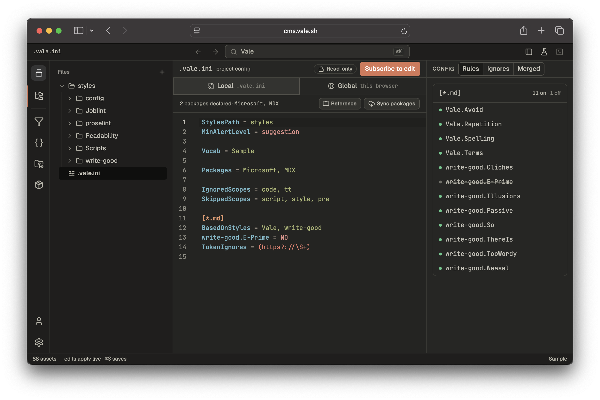

# Vale agent tools

Agent skills, a linting hook, and the Vale CMS MCP server, packaged for coding
assistants.

Everything here drives [Vale](https://vale.sh), the prose linter. The skills run
the CLI in your repository — they edit your files and open your pull requests,
and they need no account.

## Install

In Claude Code, type these two as slash commands (the second one restarts the
session so the hook and the MCP server register):

```
/plugin marketplace add vale-cli/agent-tools
/plugin install vale@agent-tools
```

You also need the `vale` binary on your `PATH`
([installation](https://docs.vale.sh/topics/installation)) — the plugin drives
it, it doesn't bundle it. `jq` too, if you want the hook.

### Check it worked

Three separate things install, and they're verified three different ways.

**The skills.** Type `/vale:` and five completions should appear — `setup`,
`fix`, `triage`, `vocab`, `ci`. That's the whole check; they're just prompts.

**The hook.** This is the one that surprises people: it runs on *Claude's*
edits, not yours. Editing a file in your own editor does nothing. To see it,
ask Claude to change a prose file in a repository that has a working Vale
config, and watch it get pulled up on any error-level alert before it moves on.

If nothing happens, that is often correct — the hook is silent unless a file
Vale lints has an **error**. Warnings and suggestions never appear. Check the
setup by hand first:

```bash
vale ls-config >/dev/null && echo "config resolves"
vale --no-exit --output=line path/to/file.md   # any `error` lines?
```

No errors there means nothing for the hook to say.

**The MCP server.** Run `/mcp` and look for `vale-cms`. Ask Claude to scaffold a
Vale rule and it should call a tool. Without a subscription every call returns a
401 naming Vale CMS — that is the server working, not a broken install.

## The skills

Ask for any of these in your own words — Claude reaches for them on its own when
the task fits — or call them directly.

| | | |
|---|---|---|
| `/vale:setup` | "add prose linting" | Installs Vale, writes a `.vale.ini` matching the formats actually present, syncs styles, and reports the first run honestly. |
| `/vale:fix` | "make vale pass" | Fixes error-level alerts a file at a time, applying the replacement each rule defines. One pull request per file. |
| `/vale:triage` | "where do we start" | Turns a first run on an existing corpus into a decision per rule: fix, downgrade, or switch off. |
| `/vale:vocab` | "stop flagging our product name" | Adds project terms to a vocabulary so spell check accepts them. |
| `/vale:ci` | "run this on PRs" | Wires Vale into GitHub Actions, pre-commit, or another runner — and says whether it blocks. |

Each states its own trigger phrases, checks its prerequisites before touching
anything, and ends with a report. A skill that can't run Vale says so rather
than improvising around it.

## The hook

`hooks/vale-edit.sh` runs every time **the assistant** writes or edits a file —
not when you do. If that file is prose and the repository has a resolvable Vale
config, it lints that one file and hands any **error-level** alerts straight
back for fixing, in the same turn.

It is silent in every other case — no Vale binary, no `jq`, no config, a file
Vale doesn't lint, or a clean run. Warnings and suggestions are never surfaced;
they're advisory by the project's own choice, and reporting them on every edit
is how people end up turning a linter off.

## The MCP server

Ask an assistant for a Vale rule and it will write plausible YAML. Whether it
compiles, whether the regex matches anything, whether the config still loads —
it has no way to find out, so you find out later, in CI.

The MCP server gives it the real engine to check against: `scaffold_rule` to
start from something valid, `diagnose_rule` and `test_rule` to find out whether
it works, `stress_rule` for the false positives the examples miss, `diff_rule`
before changing a rule already in use, `audit_style` for what the style costs to
run, and the rest.

It is the same engine behind [Vale CMS](https://vale.sh/cms), the hosted editor
— here showing a `.vale.ini` beside the rules it resolves to, with
`write-good.E-Prime` struck through because line 13 disables it:



**This one is not free.** It needs an active Vale CMS Pro or Site subscription,
and there's a one-month trial. Claude Code prompts you to sign in the first time
a tool is called; other clients paste an MCP token from Settings in Vale CMS.
Until then the server answers with a 401 explaining exactly that — nothing else
in this plugin depends on it, and the skills and hook work without it.

## How this relates to Vale CMS

[Vale](https://vale.sh) is the free, MIT-licensed linter.
[Vale CMS](https://vale.sh/cms) is a paid hosted product running Vale's engine —
the same twelve check types, the same regex compilation, the same scopes. This
repository sits across both:

| | Runs where | Needs an account |
|---|---|---|
| **Skills** | the `vale` CLI, in your repository | no |
| **Hook** | the `vale` CLI, on your machine | no |
| **MCP server** | Vale CMS, at `api.vale.sh` | yes |

The skills and the hook **consume** styles — they run rules that already exist
and act on the alerts. The MCP server **authors and verifies** them. That is why
it is the paid piece: running a linter is Vale's job and it is free, while
handing an assistant a live engine to check its own work against is what Vale
CMS is.

## Requirements

- **The skills** need the `vale` binary on `PATH`
  ([installation](https://docs.vale.sh/topics/installation)).
- **The hook** needs `vale` and `jq`, plus any POSIX shell. It is plain `sh`,
  verified against `sh`, `bash`, `zsh`, and `dash`.
- **Windows** works, but the hook needs Git Bash installed. Without it Claude
  Code falls back to PowerShell, which cannot run a shell script, and the hook
  does nothing. The skills and the MCP server are unaffected.

Each part is independent, and a missing piece degrades quietly rather than
breaking the others.

## Other clients

`skills/` is a plain skills directory, so most clients can read it as-is: copy
the folders you want into wherever your assistant looks for them (for example
`.claude/skills/`, `.cursor/skills/`), or point a skills installer at this
repository.

For a setup with no skill support, hand it <https://vale.sh/AGENTS.md> instead —
it covers the same ground as prose.

## Development

Load the plugin without installing it:

```
claude --plugin-dir /path/to/agent-tools
```

Then `/reload-plugins` to pick up edits. Validate before pushing:

```
claude plugin validate /path/to/agent-tools
```

## License

MIT
