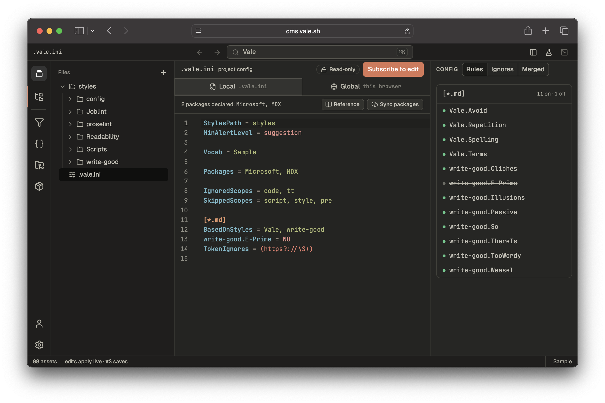

# The MCP server

Ask an assistant for a Vale rule and it will write plausible YAML. Whether it
compiles, whether the regex matches anything, whether the config still loads —
it has no way to find out, so you find out later, in CI.

The MCP server gives it the real engine to check against: `scaffold_rule` to
start from something valid, `diagnose_rule` and `test_rule` to find out whether
it works, `stress_rule` for the false positives the examples miss, `diff_rule`
before changing a rule already in use, `audit_style` for what the style costs to
run, and the rest.

It is the same engine behind [Vale CMS](https://vale.sh/cms), the hosted editor
— here showing a `.vale.ini` beside the rules it resolves to, with
`write-good.E-Prime` struck through because line 13 disables it:

**This one is not free.** It needs an active Vale CMS Pro or Site subscription,
and there's a one-month trial. Claude Code prompts you to sign in the first time
a tool is called; other clients paste an MCP token from Settings in Vale CMS.
Until then the server answers with a 401 explaining exactly that — nothing else
in this plugin depends on it, and the skills and hook work without it.

## Check it works

Run `/mcp` and look for `vale-cms`. Ask Claude to scaffold a Vale rule and it
should call a tool. Without a subscription every call returns a 401 naming Vale
CMS — that is the server working, not a broken install.

## How this relates to Vale CMS

[Vale](https://vale.sh) is the free, MIT-licensed linter.
[Vale CMS](https://vale.sh/cms) is a paid hosted product running Vale's engine —
the same twelve check types, the same regex compilation, the same scopes. This
repository sits across both:

| | Runs where | Needs an account |
|---|---|---|
| **Skills** | the `vale` CLI, in your repository | no |
| **Hook** | the `vale` CLI, on your machine | no |
| **MCP server** | Vale CMS, at `api.vale.sh` | yes |

The hook and most of the skills **consume** styles — they run rules that
already exist and act on the alerts. `tune` and `from-guide` also write rules,
and check them the way anyone can: with `vale test`, against cases kept beside
the rule. The MCP server goes further than a pass or fail — diagnosing why a
pattern does not match, stress-testing for false positives the cases miss,
diffing a change against a rule already in use. That is why it is the paid
piece: running and testing a linter is Vale's job and it is free, while
handing an assistant a live engine to check its own work against is what Vale
CMS is.
