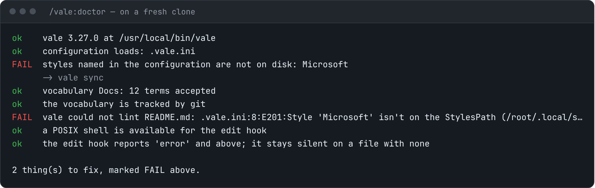
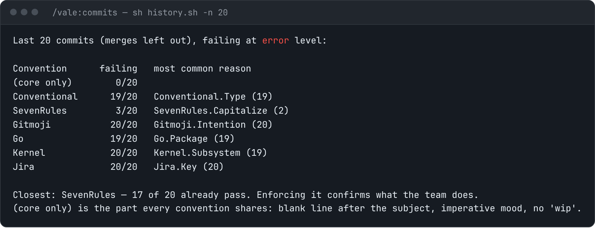

# Skills

Ask for any of these in your own words — Claude reaches for them on its own when
the task fits — or call them directly.

| | | |
|---|---|---|
| `/vale:onboard` | "set up vale end to end" | Previews the whole baseline in a temp directory — package, vocabulary, a decision per noisy rule, CI — shows it with before/after counts, and applies it on one yes. |
| `/vale:setup` | "add prose linting" | Installs Vale, writes a `.vale.ini` matching the formats actually present, syncs styles, and reports the first run honestly. Covers translated docs and the comments in source code. |
| `/vale:doctor` | "why is the hook silent" | Checks the setup end to end — binary, config, synced styles, vocabulary, a real run — and gives the command that fixes each thing that is broken. |
| `/vale:tune` | "use title case headings" | Changes one style choice in plain words — headings, contractions, "we", preferred terms — and writes it into the config with its reason. Ships tested templates for the choices no package covers. |
| `/vale:from-guide` | "enforce our style guide" | Turns a written style guide into the project's own rules, each linked to its section and tested against the guide's own do and don't examples. Says which statements cannot be checked. |
| `/vale:write-guide` | "document our vale rules" | Writes a readable style guide from the config — what blocks, the style choices and why, the vocabulary — in Markdown, MDX, AsciiDoc, reStructuredText, Org or HTML. |
| `/vale:rule` | "flag this phrase" | Writes one rule for a house convention, with a case that fires and a case that must not, proves it with `vale test`, and counts it on the real corpus before it is enabled. |
| `/vale:ignore` | "it's flagging our shortcodes" | Takes text that isn't prose — shortcodes, templating tags, generated blocks, one quoted passage — out of Vale's view at the narrowest scope that works, without switching a rule off. |
| `/vale:commits` | "lint our commit messages" | Scores your recent history against the common conventions, sets up the one it already follows, and adds the hook and the CI check. |
| `/vale:fix` | "make vale pass" | Fixes error-level alerts a file at a time, applying the replacement each rule defines. One pull request per file. |
| `/vale:triage` | "where do we start" | Turns a first run on an existing corpus into a decision per rule — fix, keep, downgrade, or switch off — and writes the agreed ones into `.vale.ini` with the reason. |
| `/vale:vocab` | "stop flagging our product name" | Adds project terms to a vocabulary so spell check accepts them. Imports a word list you already keep for `cspell` or another spell checker. Tells you whether the docs lean American or British, sets up a regional dictionary if you want one enforced, and installs dictionaries for other languages. |
| `/vale:ci` | "run this on PRs" | Sees what the repository already has, then generates the GitHub Actions workflow or the pre-commit entry — advisory or blocking — from a script, not from memory. Asks what it should look at (new lines, changed files, everything), what to report and when to fail. Covers other runners too. |

Each states its own trigger phrases, checks its prerequisites before touching
anything, and ends with a report. A skill that can't run Vale says so rather
than improvising around it.

The read-only scripts the skills run — the preview and the rule inventory — are
pre-approved in the skills' own frontmatter, so Claude Code does not stop to ask
before each one. The installer is not: installing software still prompts.

On Windows the helper scripts — preview, inventory, dictionary — need Git Bash;
without it the skills do those steps by hand. Installing Vale needs no shell:
`setup` ships a PowerShell installer that uses `winget`, Scoop or Chocolatey, or
the release zip.

## Running the preview by hand

`onboard` ships a small script, `skills/onboard/scripts/preview.sh`, that you
can also run by hand to see what a package would report before adopting it. It
needs only `vale` and writes nothing to the repository:

```bash
sh skills/onboard/scripts/preview.sh -p Google docs/
```

## Examples

`/vale:doctor` on a fresh clone, where the styles were never synced — the most
common reason Vale "stops working":



`/vale:commits` scoring this repository's own history before suggesting a
convention:



## Other clients

`skills/` is a plain skills directory, so most clients can read it as-is: copy
the folders you want into wherever your assistant looks for them (for example
`.claude/skills/`, `.cursor/skills/`), or point a skills installer at this
repository.

For a setup with no skill support, hand it <https://vale.sh/AGENTS.md> instead —
it covers the same ground as prose.
