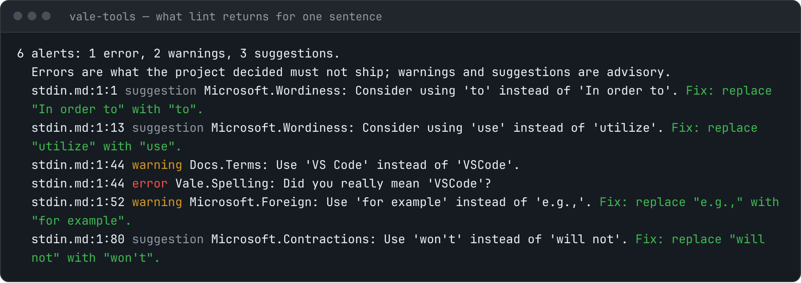

# vale-tools

Vale as tools Claude can call directly, with no shell command in between.

```
/plugin marketplace add vale-cli/agent-tools
/plugin install vale-tools@agent-tools
```

| Tool | What it does |
|---|---|
| `lint` | Lints a draft (`text`) or a file or directory (`path`) against the project's own rules and vocabulary. Each alert comes back with its line, severity, rule, message and, where the rule carries one, the exact replacement. |
| `test` | Runs the test cases kept beside the project's own rules (`vale test`), for one style or all of them, optionally with `coverage`. |

Both only read.

In the desktop app it also adds two rows to the right-click menu on selected
text: **Check with Vale**, and, for a single word, **Add to Vale vocabulary**.
Each puts a request in the prompt for you to send; neither acts by itself.



## Why a tool and not a command

- **A draft can be checked before it is written.** `lint` takes text, so Claude
  can lint a paragraph, a page or a commit message it is about to write.
  `as_path` says where the draft will live, so the rules for that location
  apply: `docs/guide/install.md`, or `COMMIT_EDITMSG` for a commit message.
- **The result is already read.** Vale's JSON is turned into one line per alert;
  nothing has to be parsed with `jq`.
- **No shell.** It starts `vale` directly, so it works on Windows without Git
  Bash, which the edit hook and the helper scripts need.

`lint` is listed to the model from the start of a session; `test` is loaded
when it is asked for.

## What it needs

`vale` on `PATH`, and a Vale configuration in the project. Without one, `lint`
says so and points at the `onboard` skill from the main `vale` plugin.

## Experimental

Built on Claude Code's function-hook plugin API, which is early access and
changes between releases.

## Developing

```
claude plugin validate plugins/vale-tools
claude plugin test plugins/vale-tools
```
